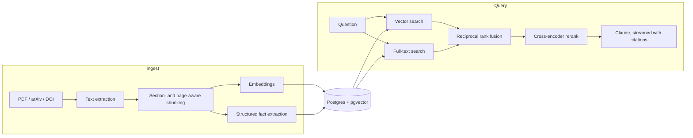

# Nosramus

A research assistant that answers questions about the papers in your library and cites the
exact passages it used, so every claim can be checked against the source.

**Live:** [nosramus.vercel.app](https://nosramus.vercel.app)

<!-- Add a screenshot or short GIF of a cited answer here:  -->

## What it does

- **Build a library.** Search arXiv and Semantic Scholar, paste a DOI or arXiv link, or upload
  a PDF. Each paper is parsed, chunked and embedded in the background.
- **Ask questions.** Answers stream in with numbered citations. Clicking a citation shows the
  quoted passage with its paper, page and section.
- **Compare papers.** For multi-part or comparative questions the model can run several
  searches over the library before answering, and conflicting claims between papers are
  shown in their own panel.
- **Scope a conversation** to specific papers, or search the whole library.
- **Track cost.** A usage page shows latency, token counts and estimated cost per query.

## How it works



**Retrieval.** Each query runs vector similarity search (pgvector) and Postgres full-text
search in parallel. The two ranked lists are merged with reciprocal rank fusion, the top 30
candidates are reranked by a Voyage cross-encoder, and results are capped per paper so one
long document cannot crowd out the rest (`lib/retrieval.ts`). If reranking is unavailable the
fused ranking is used as a fallback.

**Chunking.** Text is split on paragraph boundaries with overlap between chunks, tracking the
page number and the most recent section heading. Oversized paragraphs are split by sentence,
then by word, so no chunk exceeds the token budget (`lib/chunking.ts`).

**Generation.** The model only sees the retrieved excerpts and must cite them by number. Its
answer is post-processed to renumber citations and to pull out any contradictions it found
between papers (`lib/prompt.ts`, `lib/contradictions.ts`). A bounded tool-use loop of up to
three searches gathers context for harder questions (`lib/agent-retrieval.ts`).

**Data and security.** Supabase Auth with Google sign-in. Every table uses row-level security
so users only ever see their own papers, chunks and conversations. PDFs live in a private
storage bucket, and the service-role key is only used server-side. The schema is versioned in
`supabase/migrations/`.

**Performance.** Repeated questions over the same papers are served from a one-hour response
cache (`lib/query-cache.ts`), and every query logs retrieval and generation latency, tokens
and cost (`lib/query-log.ts`).

## Testing and evaluation

- **Unit tests** (Vitest) cover chunking, rank fusion, prompt building, contradiction parsing
  and redirect validation: `npm test`.
- **Retrieval and answer evaluation.** `npm run eval` runs a golden set of questions
  (`eval/golden-set.json`) through the real pipeline, checks whether the expected passages
  were retrieved and the expected keywords appear, and scores answer faithfulness against
  the source.
- **CI.** GitHub Actions runs type-checking, linting, tests and a production build on every
  push and pull request.

## Stack

| Layer      | Choice                                           |
| ---------- | ------------------------------------------------ |
| Framework  | Next.js 16 (App Router), React 19, TypeScript    |
| Styling    | Tailwind CSS v4                                  |
| Auth       | Supabase Auth (Google OAuth)                     |
| Database   | Supabase Postgres, pgvector, full-text search    |
| Storage    | Supabase Storage (private `papers` bucket)       |
| Generation | Anthropic Claude (streaming, tool use)           |
| Embeddings | Voyage AI (default) or OpenAI, both 1024 dims    |
| Reranking  | Voyage rerank                                    |
| Hosting    | Vercel                                           |

## Run locally

```bash
npm install
cp .env.example .env.local   # then fill in the values
npm run dev
```

Apply the database schema before first use. [SETUP.md](SETUP.md) walks through every
account, key and dashboard setting. Visit `/setup` in the running app to check the
configuration.

| Command             | What it does                             |
| ------------------- | ---------------------------------------- |
| `npm run dev`       | Start the dev server                     |
| `npm test`          | Run the unit tests                       |
| `npm run eval`      | Run the retrieval and answer evaluation  |
| `npm run typecheck` | Type-check                               |
| `npm run lint`      | Lint                                     |
| `npm run build`     | Production build                         |

## Project structure

```
app/
  (app)/              signed-in app: chat, library, usage
  api/
    chat/             retrieval and streaming answers
    papers/           list, upload, import, search, delete, retry
    conversations/    list, read, rename, delete
  login/  setup/  auth/callback/
components/           chat view, citations, contradictions, library, sidebar
lib/
  supabase/           browser, server and service-role clients
  sources/            arXiv, Semantic Scholar, identifier resolution
  chunking.ts         paragraph- and section-aware splitter
  embeddings.ts       provider-agnostic embedding calls
  ingest.ts           extract, chunk, embed, store
  retrieval.ts        hybrid search, rank fusion, rerank, per-paper caps
  agent-retrieval.ts  multi-search tool-use loop
  prompt.ts           system prompt and excerpt formatting
scripts/eval.ts       golden-set evaluation
supabase/migrations/  schema, RLS policies, search functions, storage bucket
proxy.ts              session refresh and route protection
```
